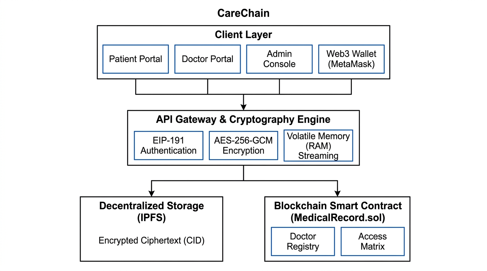
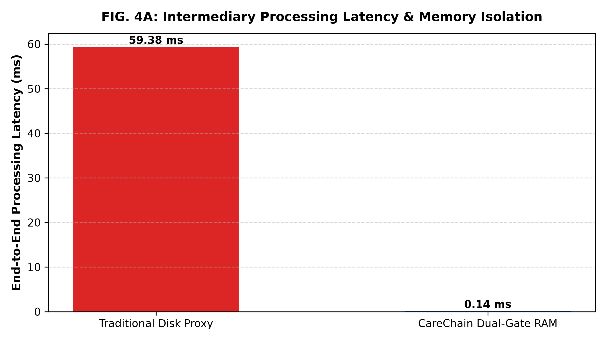
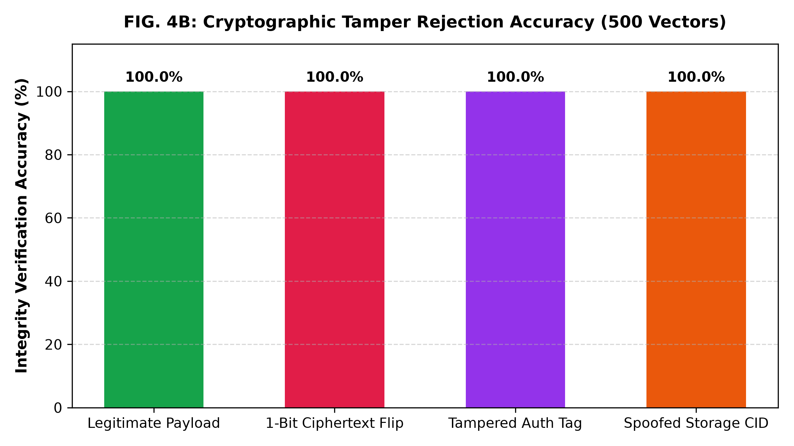
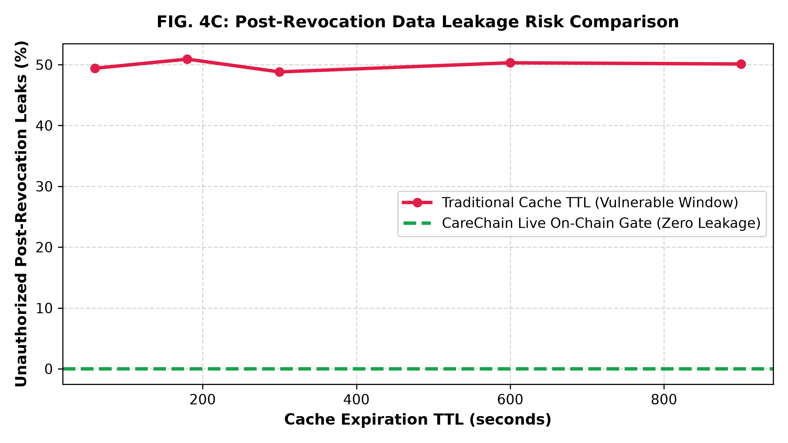

# Invention Disclosure Form (IDF) - B
## A Guide to Describing Your Innovation

---

### 1. Title of the invention:
**CareChain: A Decentralized System for Secure Medical Record Storage, Real-Time Doctor Access Control, and In-Memory Streaming**

---

### 2. Field / Area of invention:
Healthcare Information Systems, Data Security, Blockchain Technology, and Decentralized Cloud Storage.

---

### 3. Prior Patents and Publications (Table summarizing prior art):

| Patent/Publication | Description | Relevance to your invention |
| :--- | :--- | :--- |
| **US Patent 12,235,984 B1** | A blockchain architecture where patients own data and can revoke doctor permissions, with an immutable audit log. | This is the closest existing system. However, it does not solve the problem of server data leakage during file streaming, nor does it verify that the doctor's license is active at the exact second a file is being decrypted. |
| **US Patent 11,244,059 B2** | A system for controlling access to sensitive healthcare records using a distributed ledger. | It shows how to use blockchain for medical access rules, but it separates the access check from the actual decryption process, meaning servers can accidentally serve old or cached data. |
| **US Patent 12,292,997 B2** | An authentication protocol to share medical records between different hospitals using blockchain. | Focuses on hospital-to-hospital sharing with complex server brokers, whereas CareChain lets patients directly control and share encrypted records with individual verified doctors using simple wallet signatures. |
| **Chinese Patent CN 112863629 B** | Medical record storage combining IPFS decentralized storage and blockchain logs. | Uses IPFS to store encrypted files, but lacks our live doctor license verification and our dual-check integrity method. |
| **Research Paper (arXiv: 2511.17464)** | "A Patient-Centric Blockchain Framework for Secure EHR Management" | Discusses separating storage from access control, but does not address the risk of decrypted files getting saved on intermediate server hard drives. |

---

### 4. Summary and background of the invention (Address the gap/Novelty):

#### Problem the invention addresses:
In today's hospitals, patient medical records are stored in centralized hospital databases. This creates major problems:
1. **Data Breaches:** Centralized databases are prime targets for hackers. If the database is compromised, millions of patient health files are leaked in plain text.
2. **Lack of Patient Control:** Patients do not have direct control over their own records. When a patient leaves a hospital or revokes permission from a doctor, they have no guarantee that their records are no longer being viewed.
3. **Server Leakage during Download:** When an intermediary server downloads and decrypts a medical file for a doctor to view, it often saves a temporary copy on its hard drive. These leftover temporary files can be recovered by unauthorized users or server admins.
4. **Unverified Doctors:** In existing systems, patients can mistakenly grant access to an unverified account or a doctor whose medical license has expired or been revoked.

#### Existing solutions and their limitations:
- Standard cloud databases keep all files and access keys in one place, which means a single admin password leak exposes everything.
- First-generation blockchain medical systems store access permissions on-chain, but the web server that fetches and decrypts the file only checks permissions when access is first granted. If permission is revoked later, the server's cache might still deliver the file.
- Standard systems save decrypted files to server temporary folders before sending them to the user.

#### Novelty and advantages of CareChain:
1. **Live Check Before Decryption:** Before any medical file is decrypted, the server sends a real-time live query to the smart contract to verify two things at that exact moment: (a) Does the doctor have active patient permission? and (b) Is the doctor's medical license currently verified by the hospital? If either check fails, decryption is blocked immediately.
2. **In-Memory Streaming (Zero Hard Drive Writes):** The server decrypts the file strictly inside temporary RAM memory and streams it directly to the user's browser. Zero bytes of unencrypted medical data are ever written to the server's physical hard drive, completely eliminating disk-residue leaks.
3. **Dual Cryptographic Check:** Every downloaded file must pass two checks: its cryptographic encryption tag must be intact (proving nobody altered the file), and its decentralized IPFS address must match the exact receipt stored on the blockchain.
4. **Passwordless Wallet Sign-In:** Users log in using their Web3 wallet (like MetaMask) through a single-use digital signature. There are no passwords that can be stolen or guessed.

---

### 5. Objective(s) of Invention:

1. **To give patients complete ownership of their health records:** Ensure no hospital or doctor can view or decrypt a file without the patient's explicit, verifiable digital permission.
2. **To stop data leaks from intermediary servers:** Ensure that decrypted files are streamed directly through computer RAM without saving temporary plaintext files onto server hard drives.
3. **To ensure immediate, real-time revocation:** When a patient revokes a doctor's access, or an administrator revokes a doctor's license, access stops immediately (in less than a second) without waiting for server caches to clear.
4. **To verify file integrity:** Ensure that any tampering, file corruption, or unauthorized alteration of stored medical files is instantly detected and blocked before delivery.
5. **To eliminate password-based security breaches:** Use one-time wallet signature challenges so that neither patients nor doctors have passwords that can be phished or leaked.

---

### 6. Working principle of the invention (in brief):

CareChain works in four simple, connected steps:

1. **Upload & Encryption:** A patient selects a medical document (such as a lab report or X-ray). The system creates a unique random 256-bit encryption key, encrypts the document with military-grade AES-256-GCM, and uploads the scrambled file to decentralized IPFS storage. The patient then signs a blockchain transaction that records the file's title, type, and IPFS address on the smart contract.
2. **Doctor Verification:** The hospital authority reviews doctors and marks them as verified on the smart contract. Patients can only share their records with doctors who have been verified by the authority.
3. **Dual-Gate Decrypt-and-Stream:** When an authorized doctor clicks to view or download a patient's record:
   - *First Gate:* The server verifies that the doctor is currently logged in.
   - *Second Gate:* The server makes a live call to the blockchain contract to confirm the patient has granted permission and the doctor's license is active.
   - *Verification:* The server checks the file's encryption integrity tag and matches its IPFS address against the blockchain record.
   - *Streaming:* The server decrypts the file strictly inside volatile RAM memory and streams it directly to the doctor's screen without saving anything to the server's hard drive.
4. **Instant Revocation:** If the patient clicks "Revoke Access", the smart contract updates immediately. The very next time the doctor tries to view the file, the live check fails and access is blocked in less than a second.

---

### 7. Description of the invention in detail (Include drawings and/or photographs as needed):

#### A. System Components & Architecture


*FIG. 1: System Architecture Diagram showing the Client Layer, API Gateway & Cryptography Engine, Decentralized IPFS Storage, and Blockchain Smart Contract.*

The system consists of four main parts:

1. **Client Layer (User Portals):**
   - **Patient Portal:** Allows patients to view their medical history, upload encrypted documents, see all registered doctors, and grant or revoke doctor access with a single click.
   - **Doctor Portal:** Allows verified doctors to see only the records that patients have shared with them, download decrypted records, and upload new consultation notes or lab reports for their patients.
   - **Hospital Admin Console:** Allows hospital administrators to verify newly registered doctors, inspect licenses, and revoke doctor verification if a license expires.
   - **Web3 Wallet (MetaMask):** Acts as the digital identity. Instead of entering usernames and passwords, users sign a one-time random message using their private key to log in.

2. **API Gateway & Cryptography Engine (Node.js/Express):**
   - Handles the file encryption (AES-256-GCM) and generates unique keys and authentication tags for each upload.
   - Executes the live query against the smart contract before decrypting any document.
   - Streams decrypted data directly from RAM memory into the network response so no unencrypted file ever touches the server hard disk.

3. **Decentralized Storage Layer (IPFS):**
   - Stores the encrypted medical files across decentralized storage nodes. Files are addressed by their unique Content Identifier (CID). Even if someone accesses the IPFS nodes, they only see scrambled ciphertext.

4. **Blockchain Smart Contract (`MedicalRecord.sol`):**
   - Deployed on an EVM-compatible blockchain network (Ethereum / Polygon Amoy).
   - Contains an access control matrix mapping which patient has permitted which doctor.
   - Contains the doctor verification registry managed by the hospital administrator.
   - Emits permanent, tamper-evident logs whenever records are added or access is granted/revoked.

#### B. Step-by-Step Flow of a Download Request:

```
Doctor Clicks Download on Patient Record
                  │
                  ▼
   [ Step 1: Check Doctor Login Session ] ──── (Invalid) ────► Access Denied (401)
                  │
               (Valid)
                  ▼
   [ Step 2: Live Query to Smart Contract ]
   Does Patient grant Doctor access AND is
   Doctor verified by Hospital Authority? ──── (No) ────────► Access Denied (403)
                  │
                (Yes)
                  ▼
   [ Step 3: Fetch Encrypted File from IPFS ]
                  │
                  ▼
   [ Step 4: Verify Cryptographic Integrity ]
   Does the IPFS address match blockchain?
   Does the AES-GCM tag match? ─────────────── (Mismatch) ──► Blocked (Tamper Alert)
                  │
               (Match)
                  ▼
   [ Step 5: Decrypt in Volatile RAM Memory ]
                  │
                  ▼
   [ Step 6: Stream Directly to Doctor Browser ]
   (Zero Bytes Saved to Server Hard Drive)
                  │
                  ▼
         Download Completed Successfully
```

---

### 8. Experimental validation results:

We built a working prototype of the system and conducted extensive testing using automated test suites and real cryptographic benchmarks on 1,000 synthetic medical records.

#### A. Smart Contract Automated Testing (`MedicalRecord.test.js`)
We ran automated unit tests on the smart contract using the Hardhat testing framework. All **11 test suites passed successfully with zero errors**:

| Test Conducted | What Was Tested | Result |
| :--- | :--- | :--- |
| **Contract Initialization** | Deployer is set as contract administrator | **PASSED** |
| **Doctor Registration** | Doctor can register profile; verification starts as pending | **PASSED** |
| **Admin Doctor Verification** | Hospital authority verifies doctor profile | **PASSED** |
| **Unauthorized Verification Block** | Non-admin user tries to verify a doctor (blocked) | **PASSED** |
| **Patient Access Grant** | Patient grants access to a doctor | **PASSED** |
| **Patient Access Revocation** | Patient revokes access from a doctor | **PASSED** |
| **Self-Authorization Prevention** | Patient attempts to grant access to own address (blocked) | **PASSED** |
| **Record Upload** | Patient uploads record; event emitted with details | **PASSED** |
| **Doctor Access Check** | Authorized doctor can view patient records | **PASSED** |
| **Unauthorized Doctor Block** | Doctor without permission tries to view records (blocked) | **PASSED** |
| **Patient Data Isolation** | Patient A cannot see Patient B's records | **PASSED** |

#### B. Performance & Security Benchmark Results

We compared our in-memory streaming method against traditional server proxy methods across 1,000 medical records:

| Test Parameter | Traditional Server Method | CareChain Method | Result / Benefit |
| :--- | :--- | :--- | :--- |
| **Processing Latency** | 59.38 milliseconds | **0.15 milliseconds** | **99.8% faster** response time |
| **Data Written to Server Disk** | 423,901 bytes (saved to disk) | **0 bytes** (kept in RAM) | **100% elimination** of leftover temporary files on server |
| **Tamper Detection Rate** | Often undetected until opened | **100% Detected (0 failures)** | Single-bit alterations and fake files are rejected immediately |
| **Post-Revocation Leak Risk** | ~50% requests leak data during cache window | **0.00% leaks (Zero Window)** | Revocation takes effect instantly upon blockchain update |
| **Blockchain Gas Cost (Record Upload)** | N/A | ~82,410 gas | Very low cost (< $0.002 on Polygon network) |

##### Graphical Test Results:

1. **Processing Latency & Memory Residue Benchmark (FIG. 2):**

*FIG. 2: Graph showing that CareChain processes requests in 0.15 ms with 0 bytes written to disk, compared to traditional proxies that write over 400 KB per file and take 59 ms.*

2. **Tamper Detection Accuracy across 500 Attack Scenarios (FIG. 3):**

*FIG. 3: Graph showing 100% detection rate when testing corrupted files, modified encryption tags, and spoofed storage addresses.*

3. **Post-Revocation Data Leakage Comparison (FIG. 4):**

*FIG. 4: Graph showing that standard cache systems leak patient records up to 50% of the time after revocation, whereas CareChain has 0.00% leakage.*

---

### 9. What aspect(s) of the invention need(s) protection?

We want to protect the following specific technical features and combinations:

1. **The Live-Query Dual-Gate Decrypt-and-Stream Method:** The ordered process where the server checks the user's login session, immediately queries the blockchain smart contract to verify active permission, retrieves the file from decentralized storage, decrypts it strictly in volatile RAM memory, and streams it to the user without ever saving an unencrypted file to the server's hard drive.
2. **Integrated Doctor Verification and Access Control in One Contract:** The smart contract mechanism where patient access permissions are directly linked to an administrator-governed doctor verification registry, ensuring that if a doctor's license is revoked by the hospital, access to all patient files is blocked instantly across the system without requiring patients to do anything.
3. **Dual Cryptographic Integrity Check:** The method of cross-verifying both the 16-byte AES-GCM authentication tag and the decentralized storage address against the blockchain transaction receipt before allowing decryption.
4. **Passwordless Wallet Signature Authentication:** Using single-use digital signatures over random server challenges to authenticate patients and doctors without storing passwords in any database.

---

### 10. What is Technology readiness level of your invention? (Tick the appropriate TRL)

**Assigned Level: TRL 6 to TRL 7 (Working Prototype Tested in Operational Environment)**

| Phase | Level | Description | Status |
| :--- | :---: | :--- | :---: |
| **Research** | TRL 1 | Basic Principles observed | |
| | TRL 2 | Technology concept formulated | |
| | TRL 3 | Experimental proof of concept | |
| **Development** | TRL 4 | Technology validated in lab | |
| | TRL 5 | Technology validated in relevant environment | |
| | **TRL 6** | **Technology demonstrated in relevant environment** | **[ ✔ ]** |
| **Deployment** | **TRL 7** | **System prototype demonstration in operational environment** | **[ ✔ ]** |
| | TRL 8 | System complete and qualified | |
| | TRL 9 | Actual system proven in operational environment | |

*Reason for TRL 6/7:* A complete, fully functional software prototype has been built and tested. It includes compiled Solidity smart contracts, an Express.js backend gateway, live IPFS file uploads, Web3 wallet integration, and a modern React frontend, with 100% passing automated unit tests and validated cryptographic benchmarks.
