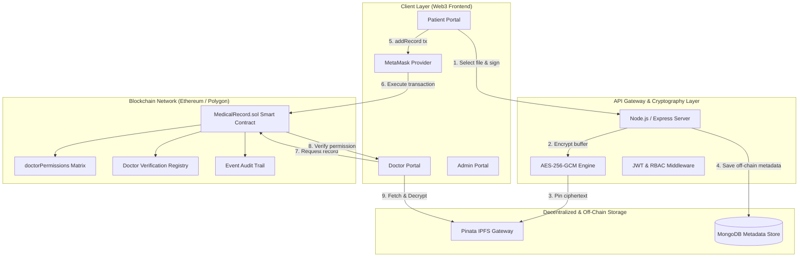

# CareChain System Architecture

## 1. Executive Summary
CareChain is architected to address the fundamental problems in traditional Electronic Health Record (EHR) systems: centralized single points of failure, unauthorized data sharing without patient consent, and lack of verifiable audit trails.

CareChain provides a **hybrid on-chain / off-chain architecture**:
- **On-Chain (Smart Contracts)**: Access permissions, doctor verification, ownership, event logs, cryptographic record hashes.
- **Off-Chain (Decentralized Storage & Gateway)**: Symmetric AES-256-GCM file encryption, IPFS storage (Pinata), and JWT-authenticated metadata services.

---

## 2. High-Level System Architecture



---

## 3. Cryptographic Data Flow

### Step 1: Client Upload & Gateway Encryption
1. The patient selects a medical document (PDF, PNG, DICOM) via the web portal.
2. The file is streamed to the gateway, where a unique **256-bit AES symmetric key**, **12-byte initialization vector (IV)**, and **16-byte authentication tag** are generated.
3. The ciphertext is constructed and pinned to the IPFS network via Pinata.
4. An immutable **IPFS Content Identifier (CID)** is generated.

### Step 2: On-Chain Registration & Authorization
1. The patient or authorized practitioner invokes `addRecord(patientAddress, ipfsCID, title, recordType, note)` on the `MedicalRecord` smart contract.
2. The contract verifies caller permissions:
   - If caller is the patient: permitted.
   - If caller is a doctor: checks `doctorPermissions[patient][caller] == true` and `doctors[caller].isVerified == true`.
3. The record is pushed to `records[patient]` mapping, and an immutable indexed `RecordAdded` event is emitted.

### Step 3: Granular Access Control Grants & Revocations
1. A patient grants a doctor access by calling `grantDoctorAccess(doctorAddress)`.
2. The contract sets `doctorPermissions[patient][doctor] = true` and emits `AccessGranted(patient, doctor)`.
3. The patient can immediately revoke access via `revokeDoctorAccess(doctorAddress)`.

---

## 4. Smart Contract Data Structures

```solidity
struct Record {
    uint256 id;
    string ipfsHash;
    string title;
    string recordType;
    string description;
    address patient;
    address uploadedBy;
    uint256 timestamp;
}

struct Doctor {
    string name;
    string specialization;
    string hospital;
    bool isRegistered;
    bool isVerified;
}

mapping(address => Doctor) public doctors;
mapping(address => Record[]) private records;
mapping(address => mapping(address => bool)) public doctorPermissions;
```
